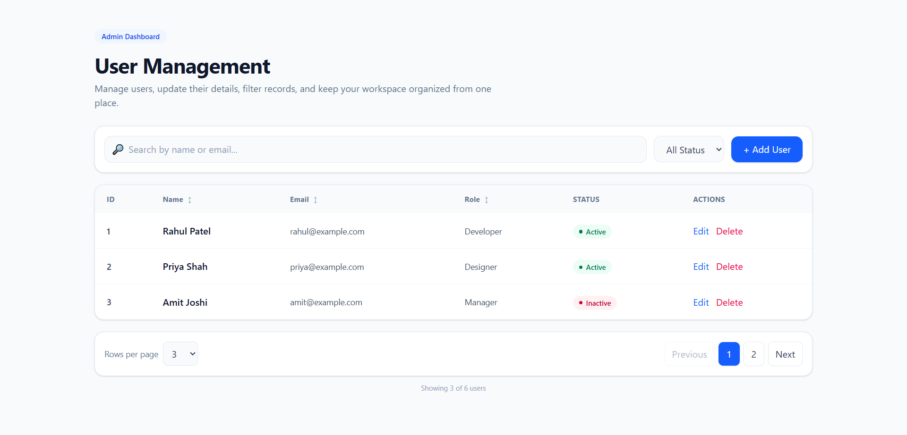

# User Management Data Table

A professional, responsive **User Management Data Table** built with **React.js, Vite, and Tailwind CSS**.

This project is designed as a student-friendly React project while keeping the UI and component structure clean enough to demonstrate in a portfolio or internship interview.

## ✨ Features

- 🔎 **Search users** by name or email
- 🎯 **Filter users** by Active / Inactive status
- ↕️ **Sort data** by Name, Email, and Role
- 📄 **Pagination** with previous/next controls and page numbers
- 🔢 **Rows per page** selection (3, 5, or 10)
- ➕ **Add new users** with name, email, role, and status
- ✏️ **Edit existing users**
- 🗑️ **Delete users** with confirmation
- 🆔 Separate **ID column**
- 📱 **Responsive table** with horizontal scrolling on smaller screens
- 🎨 Clean, professional admin-dashboard style UI
- 🧩 Modular React components for easier maintenance
- ⚡ Vite-powered development and production build

## 🛠️ Tech Stack

| Technology                  | Purpose                                  |
| --------------------------- | ---------------------------------------- |
| **React 19**                | UI and component-based application logic |
| **Vite**                    | Development server and build tool        |
| **Tailwind CSS 4**          | Styling and responsive UI                |
| **JavaScript (ES Modules)** | Application logic                        |
| **ESLint**                  | Code quality and linting                 |

## 📁 Project Structure

```text
Data Table - React/
├── public/
│   ├── favicon.svg
│   └── icons.svg
│
├── src/
│   ├── assets/
│   │   ├── hero.png
│   │   ├── react.svg
│   │   └── vite.svg
│   │
│   ├── components/
│   │   ├── DataTable.jsx
│   │   ├── Pagination.jsx
│   │   ├── UserForm.jsx
│   │   ├── UserTable.jsx
│   │   └── UserToolbar.jsx
│   │
│   ├── data/
│   │   └── users.js
│   │
│   ├── App.jsx
│   ├── index.css
│   └── main.jsx
│
├── index.html
├── vite.config.js
├── eslint.config.js
├── package.json
└── README.md
```

## 📸 Screenshots



📹 Project Explanation

https://drive.google.com/file/d/1h3VZG_8qqZrXmuJRN7d_8iwLlMK3qnIh/view?usp=drivesdk

## 🧩 Component Overview

### `DataTable.jsx`

The main component that manages the application's state and logic:

- User list state
- Search state
- Status filter
- Sorting
- Pagination
- Add user
- Edit user
- Delete user

The project intentionally does **not** use `useMemo`; the filtering and sorting logic is kept straightforward and beginner-friendly.

### `UserToolbar.jsx`

Contains:

- Search input
- Status filter
- Add User button

### `UserTable.jsx`

Responsible for displaying:

- ID
- Name
- Email
- Role
- Status
- Actions

It also handles the sort buttons and passes Edit/Delete actions back to the parent component.

### `UserForm.jsx`

A reusable form used for both:

- Adding a user
- Editing a user

Fields:

- Name
- Email
- Role
- Status

### `Pagination.jsx`

Handles:

- Current page
- Page numbers
- Previous / Next buttons
- Rows per page

### `users.js`

Contains the initial local user data used by the application.

> **Note:** This project currently uses local React state and a JavaScript data file. There is no backend or database connected.

## 🚀 Getting Started

### 1. Clone or download the project

Download the project and open the project folder in your code editor.

### 2. Install dependencies

```bash
npm install
```

### 3. Start the development server

```bash
npm run dev
```

Vite will show the local development URL in the terminal.

### 4. Create a production build

```bash
npm run build
```

### 5. Preview the production build

```bash
npm run preview
```

## 🧪 Linting

To check the project with ESLint:

```bash
npm run lint
```

## 💡 How the Data Flow Works

The main flow is:

```text
users.js
   ↓
DataTable.jsx
   ↓
Search + Status Filter
   ↓
Sorting
   ↓
Pagination
   ↓
UserTable.jsx
```

For adding and editing:

```text
UserToolbar
     ↓
UserForm
     ↓
DataTable state
     ↓
UserTable
```

For deleting:

```text
UserTable
   ↓
Delete button
   ↓
Confirmation
   ↓
DataTable state updated
   ↓
Table re-renders
```

## 📌 Current Data

The project starts with six sample users:

- Rahul Patel
- Priya Shah
- Amit Joshi
- Neha Mehta
- Karan Patel
- Jay Patel

The initial data is stored in:

```text
src/data/users.js
```

Changes made through Add, Edit, and Delete are stored in React state, so they are **temporary** and will reset when the page is refreshed.

## 🎯 Learning Goals

This project is useful for practicing:

- React functional components
- `useState`
- Props
- Event handling
- Array methods such as `filter()`, `map()`, and `sort()`
- Conditional rendering
- Form handling
- Component reusability
- Pagination logic
- Tailwind CSS
- Responsive UI design
- Basic CRUD-style frontend interactions

## 🔮 Possible Future Improvements

The current project is frontend-only. Possible next steps include:

- Connect a REST API or backend
- Store users in a database
- Add server-side pagination
- Add authentication
- Add form validation messages instead of browser alerts
- Add toast notifications
- Add confirmation modal instead of `window.confirm()`
- Persist data with `localStorage`
- Add advanced filters
- Add loading and error states
- Add automated tests

## 📄 License

This project is intended for learning, practice, and portfolio use.
